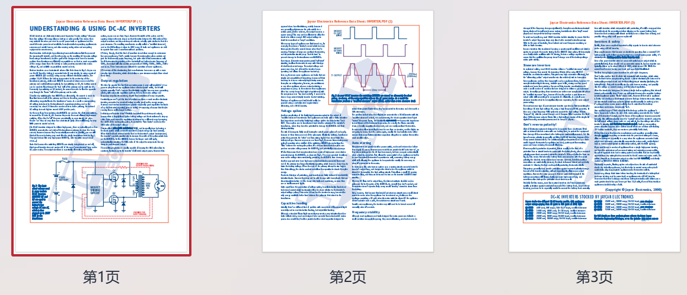

# DC-AC Inverter pdf

DC-AC inverter is an electronic device used to generate "house current voltage" AC electricity.
From low voltage DC energy (from batteries or solar panels). This makes them  .
Very suitable for those who need to use electric tools or electrical appliances, but...
The usual communication power is unavailable. Examples include operating the equipment.
Trucks, mobile homes, and audio, video, and computing operations
Equipment in remote areas.
\n        \n  

## Images

<!-- PAYMENT_BLOCK -->

## Get this dataset

- Payment link (Stripe): [Buy now](https://buy.stripe.com/3cs8yP7sY87d0vu9AB)
- Payment QR code: 

<!-- /PAYMENT_BLOCK -->
